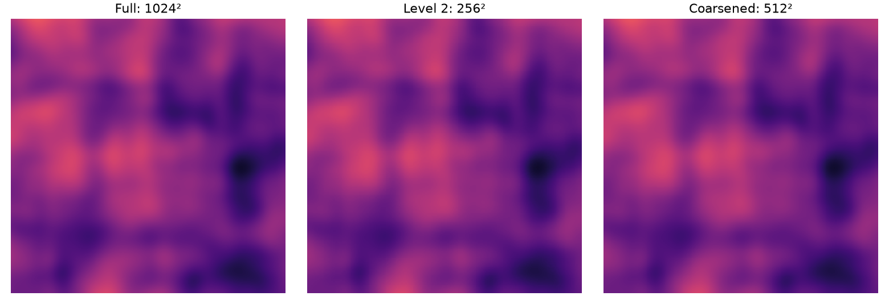
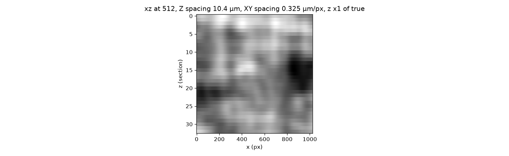
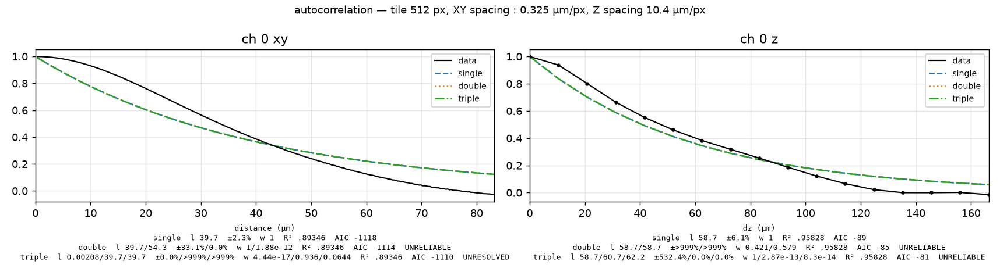
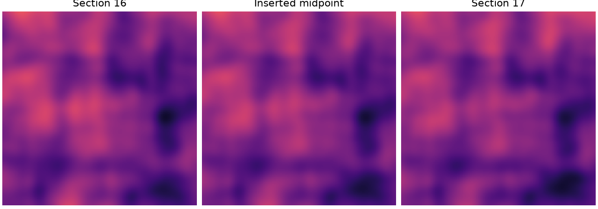
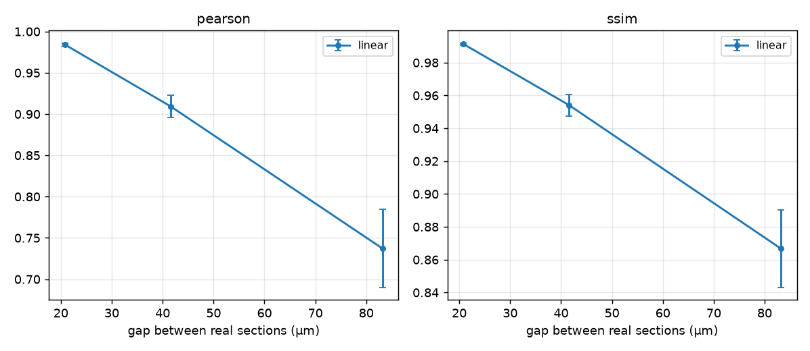
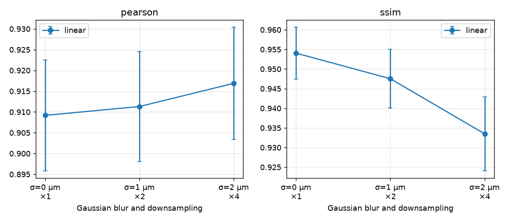

# volanis

Example run on a cubic volume of correlated tissue texture.

## Installation

Run from the project folder:

```sh
pip install -e .
# Or include McCann interpolation and Wasserstein evaluation:
pip install -e ".[ot]"
```

## Open a volume

Put your aligned TIFF sections in one folder, numbered in section order.
(All sections must have the same dimensions, channels, and data type)

```python
from pathlib import Path
import volanis

Path("output").mkdir(exist_ok=True)
volume = volanis.open_volume(
    "slices",
    xy_spacing_um=0.325,  # XY pixel size in µm
    z_spacing_um=10.4,   # Space between sections in µm
)
```

`volume.shape = (33, 1024, 1024, 1)`

### Use a lower resolution

Use `at_level()` to select a TIFF pyramid level.

```python
reduced = volume.at_level(2)  # Level 0: full resolution, 1: half, 2: quarter
```

`reduced.shape = (33, 256, 256, 1)`; XY spacing: 1.3 µm.

Use `coarsen()` to choose a downsampling factor and optional Gaussian blur at the current resolution.

```python
coarse = volume.coarsen(
    sigma_um=2.0,  # Gaussian blur sigma in µm, 0 for no blur
    factor=2,      # XY downsampling factor, 1 for no downsampling
)
```

`coarse.shape = (33, 512, 512, 1)`; XY spacing: 0.65 µm.



Both update XY spacing and leave Z unchanged.
Use `reduced` or `coarse` instead of `volume` to experiment on lower resolution.

## Plot a cross-section

```python
figure = volanis.plot_cross_section(
    volume,
    direction="xz",  # "xz" or "yz"
    index=None,      # Position in pixel, None for the centre
)
figure.savefig("output/cross_section.png")
```



## Reencode TIFFs

Save tiled, pyramidal TIFFs in a new folder:

```python
encoded = volanis.reencode(volume, "output/reencoded")
```

33 pyramidal TIFFs saved in `output/reencoded/`.

## Autocorrelation

```python
result = volanis.autocorrelation(
    volume,
    "output/autocorrelation.npz",
    channels=[0],   # First channel only, channels=None for all channels
    tile_size=512,  # Tile size in pixel
    max_tiles=16,   # Maximum tiles per channel, higher = more precise
)
fits = volanis.fit(result)
figure = volanis.plot_autocorrelation(fits, log_y=False)
figure.savefig("output/autocorrelation.png")
```



Load saved curves:

```python
result = volanis.AutocorrelationResult.load("output/autocorrelation.npz")
fits = volanis.fit(result)
```

## Interpolation

### Basic linear interpolation

```python
volanis.interpolate_linear(
    volume,
    "output/linear",   # Output folder
    frames_between=3,  # Number of new sections to insert between each pair
)
```

129 TIFFs saved, new Z spacing is 2.6 µm.



### McCann interpolation

Requires the `ot` installation option !!

```python
volanis.interpolate_mccann(
    volume,
    "output/mccann",   # Output folder
    frames_between=3,  # Number of sections to insert between each pair
    tile_size=128,     # Tile size in pixel
    channels=[0],      # First channel only, channels=None for all channels
)
```

129 TIFFs saved, new Z spacing is 2.6 µm.

## Reconstruction scoring

Keep every fourth section, reconstruct the missing three, and compare with the originals:

```python
sparse = reduced.prune(4) # return a copy of the volume with 1 section out of 4
volanis.interpolate_linear(sparse, "output/evaluation", frames_between=3)

reconstructed = volanis.open_volume(
    "output/evaluation",
    xy_spacing_um=reduced.xy_spacing_um,
    z_spacing_um=reduced.z_spacing_um / 4,
)
scores = volanis.score_reconstruction(
    reduced,
    reconstructed,
    keep_every=4,                # Same value as prune
    channel=0,                   # Channel to compare
    metrics=("pearson", "ssim", "wasserstein"),  # Metrics to compute, "wasserstein" requires the ot option
)
print(scores)
```

24 reconstructed sections scored.

```text
{
    'index':       [1, 2, 3, ...],
    'pearson':     [0.94273, 0.87463, 0.92357, ...],
    'ssim':        [0.97092, 0.93816, 0.96105, ...],
    'wasserstein': [11.81522, 13.76488, 11.19784, ...]
}
```

## Sweeps 

Define the interpolation method to use:

```python
def interpolate(sparse, folder, frames):
    volanis.interpolate_linear(sparse, folder, frames_between=frames)
```

Or use McCann:

```python
def interpolate(sparse, folder, frames):
    volanis.interpolate_mccann(sparse, folder, frames_between=frames)
```

### Section gaps

```python
metrics = ("pearson", "ssim")

gap_scores = volanis.sweep_gaps(
    reduced,
    "output/gap_sweep",
    interpolate,
    keep_everys=(2, 4, 8),  # Keep every 2nd, 4th, then 8th section
    channel=0,             # Channel to compare
    metrics=metrics,
)
volanis.plot_scores({"linear": gap_scores}, metrics=metrics).savefig("output/gap_scores.png")
```



### Coarse-graining

```python
metrics = ("pearson", "ssim")

coarse_scores = volanis.sweep_coarse_graining(
    reduced,
    "output/coarse_sweep",
    interpolate,
    keep_every=4,  # Keep every fourth section
    coarse_grainings=((0, 1), (1, 2), (2, 4)),  # Pairs of (blur sigma in µm, downsampling factor)
    channel=0,     # Channel to compare, starting at 0
    metrics=metrics,
)
volanis.plot_coarse_scores({"linear": coarse_scores}, metrics=metrics).savefig("output/coarse_scores.png")
```



## More examples

- [Volume access and coarse graining](examples/volume.py)
- [Autocorrelation](examples/autocorrelation.py)
- [Interpolation](examples/interpolation.py)
- [Reconstruction scoring](examples/evaluate.py)
- [Section gap and coarse graining sweeps](examples/sweeps.py)
